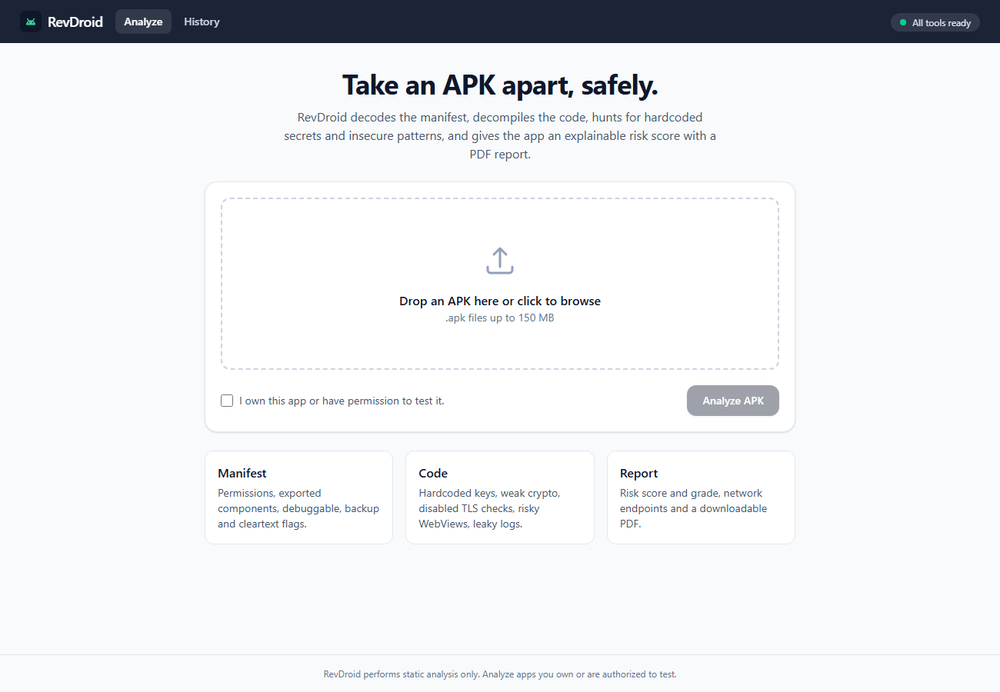
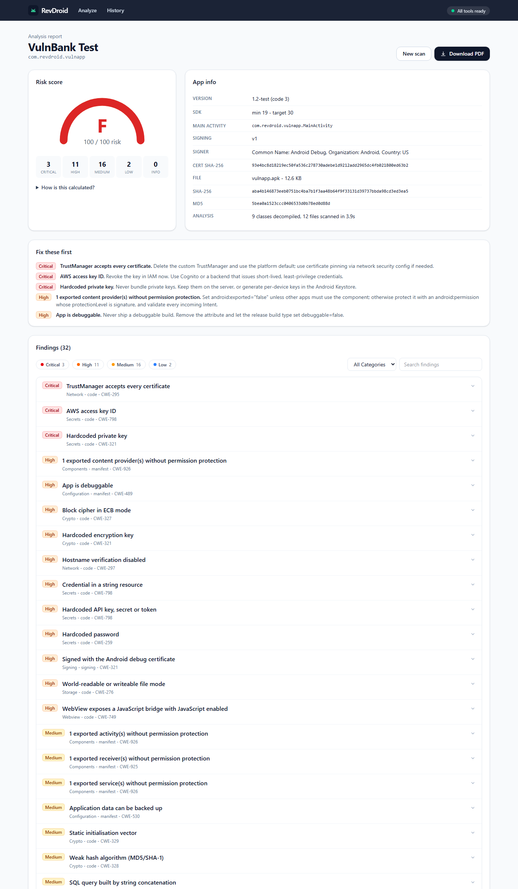
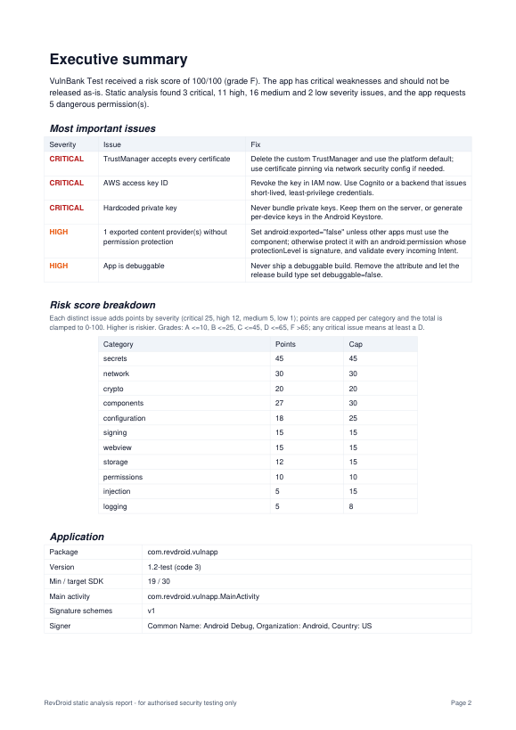

# RevDroid: APK Reverse Engineering & Security Analyzer

Upload an Android APK you own or are allowed to test. Within a minute RevDroid takes it apart the way a
reverse engineer would. It reads the manifest, classifies permissions, decompiles the code, finds
hardcoded secrets and insecure patterns, gives the app an explainable 0-100 risk score with an A-F
grade, and produces a downloadable PDF report.

> **Ethical use.** RevDroid is a defensive, educational, static-analysis tool. Only analyse apps you
> wrote or have written permission to test. It does not repackage, patch, crack or bypass anything,
> and it never shows a discovered secret in full.




<!-- replace these with your own screenshots any time -->

## Features

| Area | What it does |
|------|--------------|
| Upload | Drag-and-drop, `.apk` + size + ZIP/manifest/dex validation, per-scan folder, MD5/SHA-1/SHA-256 |
| Identity | Package, app name, version, min/target SDK, main activity, v1/v2/v3 signing, certificate details |
| Manifest | Permissions classified as normal/dangerous/signature/custom. Flags: `debuggable`, `allowBackup`, `usesCleartextTraffic`, `testOnly`, old `minSdk`, network-security-config (cleartext, user CAs). Exported activities/services/receivers/providers with no permission, including implicit export via intent-filter |
| Signing | Debug certificate, weak signature hash, v1-only signature on Android < 7 (Janus) |
| Code | jadx decompile, then 26 regex rules: AWS/Google/Stripe/GitHub/Slack keys, JWTs, private keys, passwords, generic secrets, Firebase URLs, MD5/SHA-1, ECB, DES/RC4, hardcoded keys, static IVs, trust-all TrustManager, allow-all hostname verifier, WebView SSL `proceed()`, JS bridge + JS enabled, file-URL access, sensitive logging, world-readable files, external storage, SQL concatenation, plain-HTTP URLs |
| Network | URLs, domains and IPs (public/private/loopback) from string literals in the app's own code |
| Scoring | Explainable, capped per category (see below) |
| Report | PDF with cover, executive summary, score breakdown, findings with fixes, permissions, appendix with hashes and endpoints |
| History | SQLite scan list with status, grade, PDF link and delete (removes files too) |

Every finding has a title, severity, category, explanation, fix, CWE, OWASP MASVS reference, and up to
25 locations (file, line, **masked** snippet).

## Architecture

```
 React (Vite + Tailwind)             FastAPI backend                       per-scan folder data/scans/<id>/
 ─────────────────────────           ─────────────────────────────         ────────────────────────────────
 Upload ── POST /api/scans ───────▶  validate + hash ─▶ SQLite row         app.apk
   │                                 background thread (max N at once):
   │ poll GET /api/scans/{id}        1 androguard  → identity, cert        identity.json
   │                                 2 apktool d   → manifest, res, NSC    manifest.json
   ▼                                 3 jadx        → Java sources          (decoded/, jadx/ deleted after scan)
 Results ◀─ GET …/result ──────────  4 rule scanner → findings, endpoints   code.json
   │                                 5 scorer      → score + grade         result.json
   └─ Download ◀─ GET …/report.pdf   ReportLab PDF built from result.json
```

Each step writes its own JSON, so a late failure still leaves earlier results. External tools run with a
hard timeout and a kill of the whole process tree, so a broken or huge APK cannot hang or crash the
server. Third-party library packages (androidx, okhttp, Google...) are skipped by default to keep the
noise down.

## Risk score in plain words

1. Each **distinct** issue earns points by severity: critical 25, high 12, medium 5, low 1.
   The same issue in 40 files counts once, plus a small spread bonus (at most +3).
2. Points are summed per category, and each category has a cap (secrets 45, network 30, components 30,
   configuration 25, crypto 20, ...). Twenty MD5 calls cannot outweigh one leaked AWS key.
3. Dangerous permissions add 1 point each (max 8). Signature-level permissions add 2 each.
4. The total is clamped to 0-100. **Higher means riskier.**
5. Grade: **A** ≤10, **B** ≤25, **C** ≤45, **D** ≤65, **F** >65. Any critical issue means at least a D.

The results page and the PDF both show the per-category breakdown.

## Setup (local)

Requirements: Python 3.11+, Node 18+, Java 11+ (17+ recommended).

```bash
# 1. tools: downloads apktool + jadx into tools/
python scripts/install_tools.py

# 2. backend
cd backend
python -m venv .venv
.venv\Scripts\activate            # macOS/Linux: source .venv/bin/activate
pip install -r requirements.txt
copy .env.example .env            # macOS/Linux: cp .env.example .env   (optional)
uvicorn app.main:app --reload --port 8000

# check: every tool should say "ready": true
curl http://localhost:8000/api/health

# 3. frontend (new terminal)
cd frontend
npm install
npm run dev                       # http://localhost:5173
```

## Run with Docker

```bash
docker compose up --build         # http://localhost:8080
```

The backend image bundles a JRE, apktool 3.0.3 and jadx 1.5.6. Scans live in the `revdroid-data` volume.

## Testing

```bash
cd backend
python tests/fixtures/build_vulnapp.py C:/AndroidSDK    # builds the deliberately vulnerable fixture APK
python -m pytest -q
```

`tests/fixtures/vulnapp/` is a tiny app with 32 planted issues and fake secrets. The end-to-end test
uploads it through the API and checks three things. Every planted issue must be detected. Protected
components must not be flagged. No planted secret may appear in full in the result JSON.

**Practice apps.** You can also scan [InsecureBankv2](https://github.com/dineshshetty/Android-InsecureBankv2)
or [DIVA](https://github.com/payatu/diva-android). Expect hardcoded credentials, `debuggable`/`allowBackup`,
exported components, weak crypto and plain-HTTP endpoints. Antivirus products often flag these APKs as
malicious because they are intentionally vulnerable. Download them only from the official repositories,
and only into an isolated folder.

## API

| Method | Path | Purpose |
|--------|------|---------|
| GET | `/api/health` | Java, apktool, jadx, androguard status |
| POST | `/api/scans` | multipart `file=@app.apk` → `{scan_id}` (202) |
| GET | `/api/scans` | history |
| GET | `/api/scans/{id}` | status, stage, progress |
| GET | `/api/scans/{id}/result` | full analysis JSON |
| GET | `/api/scans/{id}/report.pdf` | PDF report |
| DELETE | `/api/scans/{id}` | delete scan + files |

## Troubleshooting

| Symptom | Fix |
|---------|-----|
| `jadx ran out of memory` warning | Raise `JADX_HEAP` to `4g` or `6g` in `backend/.env` (Docker: also raise `mem_limit`) |
| `jadx timed out` | Raise `JADX_TIMEOUT_SEC`; partial output is still analysed |
| `jadx finished with errors` | Normal for obfuscated apps; some classes could not be decompiled |
| Health shows apktool/jadx missing | Run `python scripts/install_tools.py`, or set `APKTOOL_PATH` / `JADX_PATH` |
| "no classes.dex found" | You uploaded a split APK or an `.aab`; build a universal APK first |
| Upload rejected at 150 MB | Raise `MAX_UPLOAD_MB` (and `client_max_body_size` in `frontend/nginx.conf`) |

## Ideas for later

1. **Dynamic analysis with Frida.** Run the app on an emulator, hook crypto, network and storage APIs,
   and confirm static findings at runtime.
2. **OWASP MASVS / MASTG compliance view.** Every finding already carries a MASVS ID. Group them into a
   per-control pass/fail checklist in the UI and the PDF.
3. **Third-party library and CVE detection.** Fingerprint bundled SDKs and versions (OkHttp, Firebase,
   ad SDKs), match them to known CVEs, and add trackers to the privacy section.

## Project layout

```
revdroid/
├─ backend/app/        config, tools, storage, db, identity, manifest, permissions,
│                      decompile, rules, code_scanner, network, scoring, report, pipeline, main
├─ backend/tests/      unit + API + end-to-end tests, vulnerable fixture app
├─ frontend/src/       pages (Upload, Results, History) and components
├─ scripts/            install_tools.py
└─ docker-compose.yml
```
